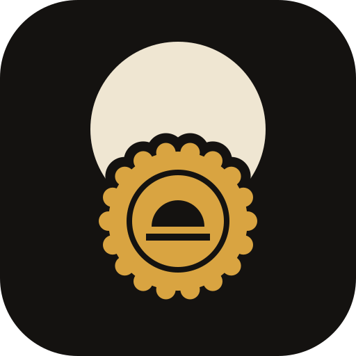

# Atelier Seal app icon

**The hidden sun behind a wax seal**: an ivory disc rising behind an ochre wax seal, scalloped at the
edge and stamped with the sun mark, on a volcanic black field. Three colours, from the Nation's
palette: volcanic black `#141210`, ivory `#efe6d2`, ochre `#d9a441`.

**Tile:** `viewBox="0 0 512 512"`, a rounded square with `rx=112`, as all the Atelier icons. Windows
and Linux icons use the full tile. macOS icons put it on Apple's grid (an 824 px body centred on a
transparent 1024 px canvas).

**Provenance:** drawn for Atelier Seal by hand as SVG (2026). It replaces PdfCraft's lion icon, which
stays in PdfCraft's own repository. Licence: [LICENSE.txt](LICENSE.txt) (`MIT OR Apache-2.0`). The
file names keep their upstream `pdfcraft` names so packaging stays untouched.

## Files

| File | What it is |
|---|---|
| `pdfcraft.svg` | the master vector; every PNG, `.ico` and `.icns` is rendered from it |
| `pdfcraft-small.svg` | the same artwork (upstream kept a lighter trace here) |
| `pdfcraft-1024.png` | 1024 px on Apple's grid; also the runtime Dock icon on macOS |
| `pdfcraft.icns` | macOS icon (16–1024 px) |
| `pdfcraft.ico` | Windows icon, 16–256 px |
| `hicolor/<size>/apps/ai.storyteller.pdfcraft.png` | Linux icon theme, 16–512 px; 256 px is also the runtime window icon on Windows and Linux |
| `hicolor/scalable/apps/ai.storyteller.pdfcraft.svg` | Linux scalable icon |

The committed renders were made from the same SVG with cairosvg and Pillow;
`packaging/icons.sh` regenerates them (needs resvg; iconutil on macOS for the `.icns`).
